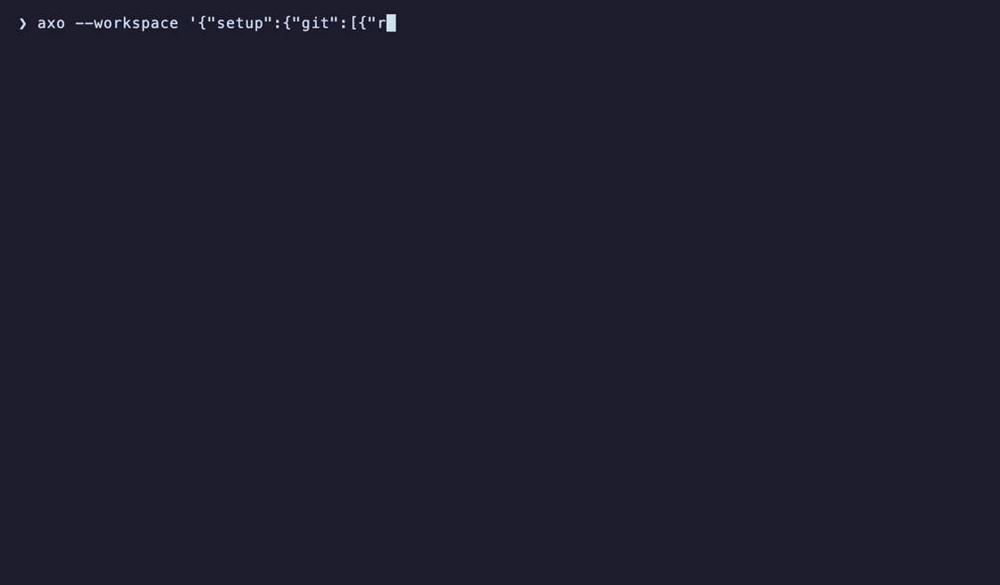
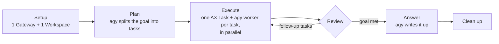
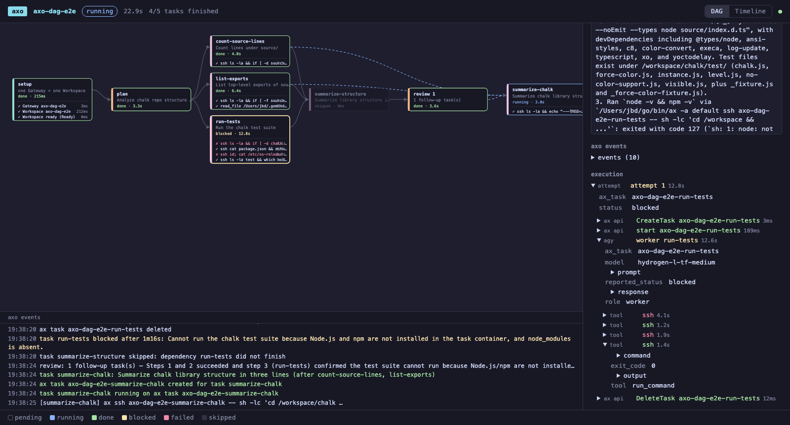

# axo

**Give it a goal. axo plans it, fans the work out across AX tasks, and hands you the answer.**



axo is a task orchestrator for [AX](https://github.com/google/ax) driven by plain `agy -p` calls (no `/swarm`). Every run gets **one Gateway and one Workspace**; every task runs in its own AX Task on top of them, in parallel.

## Quickstart

```bash
go install github.com/rakyll/axo@latest   # or `make install` from a clone

axo --workspace '{"setup":{"git":[{"repo":"https://github.com/chalk/chalk"}]}}' \
  "Why would I use this library, and what are its weak spots?"
```

Leave off the goal to type it in the TUI. Add `--dry-run` to preview everything without creating anything.

## How it works



1. **Plan:** agy splits your goal into a graph of tasks.
2. **Execute:** each task gets its own AX Task and an agy worker that works inside it via `ax ssh`. Tasks start as soon as their dependencies finish; results and patches flow to the tasks that depend on them.
3. **Review:** agy checks the results and adds follow-up tasks until the goal is met.
4. **Answer:** agy writes the final answer, and axo cleans up after itself.

## Watch it live

Press **`ctrl+t`** while axo runs to open a live view in your browser.



- **Overview:** the whole run as a graph: setup, plan, tasks and their dependencies, reviews, synthesis. Each task shows its tool calls (`ssh`, `read_file`, `write_file`) as they happen.
- **Inspect:** click any task for its goal, results, patch, events, and every attempt, prompt, command, and output.

Want it on disk? `--trace-file trace.json` saves the full trace when the run ends.

## Flags

| Flag | Default | What it does |
|---|---|---|
| `--workspace` / `--workspace-config` | | AX Workspace spec, inline JSON or a file |
| `--name` | random | Run name; resources are named `axo-<name>…` |
| `--parallel` | `4` | Tasks running at once |
| `--max-rounds` | `3` | Plan → execute → review rounds |
| `--max-retries` | `1` | Retries for a failed task |
| `--max-tasks` | `16` | Total task budget |
| `--worker-timeout` | `20m` | Time limit per worker |
| `--model` | `hydrogen-l-tf-medium` | agy model |
| `--trace-file` | | Save the execution trace as JSON |
| `--keep` | `false` | Keep AX resources after the run |
| `--dry-run` | `false` | Print the plan without running anything |

Run `axo --help` for the rest (`--allow-host`, `--atespace`, `--context`, `--server`, `--effort`, `--mode`, `--allow`, …).

## Good to know

- **Talks to the AX control plane directly.** axo manages Gateways, Workspaces, and Tasks through the AX gRPC API, not the `ax` CLI.
- **Workers still use `ax ssh`.** The API has no exec call, so point `--ax-bin` (or `AX_BIN`) at an `ax` that matches your cluster's version.
- **Cleans up after itself.** Everything it creates starts with `axo-`, and all of it is deleted when the run ends (or on `ctrl+c`), unless you pass `--keep`.
- **Never touches what it didn't create.** If a resource with the run's name already exists, axo stops.
- **The trace viewer is local only.** It's served on `127.0.0.1`, behind a one-time link.

## Develop

```bash
go test -race ./...
```
