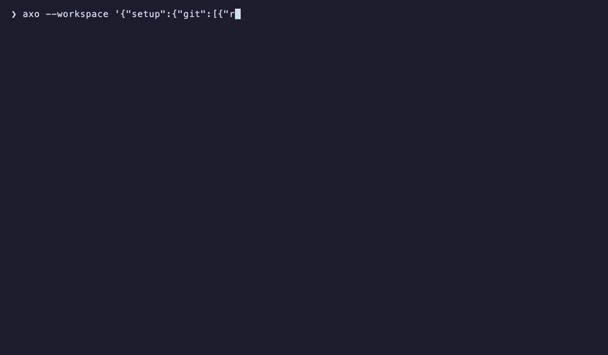

# axo

A custom AX task orchestrator built on plain `agy -p` calls. It does **not** use agy's `/swarm` mode. The command line looks like [`ax-swarm`](../README.md): same flags, a Bubble Tea TUI when run in a terminal, and timestamped logs when headless. The difference is that the Go program runs the orchestration loop itself.

Every run creates **exactly one AX `Gateway` and one AX `Workspace`**. Every task runs in its own AX `Task`, and all of those Tasks share that one Workspace and Gateway. Every resource name starts with `axo-`: for run name `<name>`, the Gateway and Workspace are `axo-<name>` and the Tasks are `axo-<name>-<task-id>`.



## AX Control Plane API

axo manages AX resources through the **AX control plane API**, the `ax.v1alpha1.AX` gRPC service served by `ax-server`. It uses the public Go client [`github.com/google/ax/client`](https://github.com/google/ax) (pinned to `v0.4.0-rc.2`), not the `ax` CLI:

| Operation | RPC |
|---|---|
| Create the run's Gateway / Workspace | `CreateGateway`, `CreateWorkspace` (returns once the Workspace is pre-warmed) |
| Watch Workspace setup | `GetWorkspace` (`status.phase`, `status.last_setup_error`) |
| Create, start, and watch a task's AX Task | `CreateTask`, `ResumeTask`, `GetTask` |
| Live task table and cleanup | `ListTasks` (paginated), `DeleteTask`, `DeleteWorkspace`, `DeleteGateway` |

The server is located the same way `ax` finds it: `--server` / `$AX_SERVER` if set, otherwise a port-forward to `svc/ax-server` in the kubeconfig context (`--context`). That port-forward is shared with the `ax` CLI and requires `kubectl`. Workspace specs are decoded strictly with `protojson`, so a misspelled field fails validation, including in `--dry-run`, before anything is created. If a Gateway or Workspace with the run's name already exists, axo stops. It never adopts or deletes resources it did not create.

> [!NOTE]
> Running commands *inside* a Task is not part of the control plane API: there is no exec RPC. Commands go to the Task's guest daemon through the mTLS atenet-router, and only the `ax` CLI implements that path. So agy workers still run `ax ssh <task> -- …`, and `--ax-bin` must point at an `ax` that matches the cluster's AX version. Everything else axo does goes through the gRPC API.

## How It Works

```mermaid
flowchart LR
  S["Setup: 1 Gateway + 1 Workspace"] --> P["Plan (agy, JSON schema)"]
  P --> E["Execute task DAG<br/>one AX Task + agy worker per task<br/>up to --parallel at once"]
  E --> R{"Review (agy, JSON schema)"}
  R -- "follow-up tasks" --> E
  R -- complete / --max-rounds --> Y["Synthesize answer (agy)"]
  Y --> C["Cleanup: tasks, Workspace, Gateway"]
```

1. **Setup**: Creates one Gateway and one Workspace named `axo-<name>` through the control plane API, then waits until the Workspace is `Ready`.
2. **Plan**: A planner `agy -p --json-schema …` call splits the goal into a dependency graph of tasks. If planning fails, the whole goal runs as one task.
3. **Execute**: The orchestrator runs tasks as soon as their dependencies finish, up to `--parallel` at a time. For each task it:
   - creates the AX Task `axo-<name>-<task-id>`, pointing at the shared Workspace and Gateway;
   - resumes the AX Task and waits until it is `Running`;
   - runs one `agy -p` worker that may only call `ax ssh <task> …`;
   - parses the worker's JSON report (`done` / `blocked` / `failed`, plus a summary, details, and an optional patch);
   - deletes the AX Task.

   Failed workers are retried up to `--max-retries` times in a fresh AX Task (`axo-<name>-<id>-r2`). Dependent tasks receive the reports and patches of the tasks they depend on. Each AX Task has its own copy of `/workspace`, so file changes only move between tasks as patches. If a dependency does not finish, the tasks that depend on it are skipped.
4. **Review**: A reviewer call decides whether the goal is complete. If it isn't, the reviewer adds follow-up tasks and another round starts. This repeats up to `--max-rounds` rounds and `--max-tasks` tasks in total.
5. **Synthesize**: A final `agy -p` call writes the answer from all task reports and streams it to stdout.
6. **Cleanup**: Deletes any remaining `axo-<name>-*` Tasks, then the Workspace and the Gateway, unless `--keep` is set.

Every agy call passes `--disable-slash-commands`, so the goal text can never trigger `/swarm` or any other agy command. Planner, reviewer, and synthesizer calls get no tool permissions. Workers only get `command(<ax binary>)` (plus any `--allow` rules), through a per-session `--settings` that is never saved.

## Execution Traces

axo records an execution trace of every run: a tree of timed spans covering setup (`CreateGateway`, `CreateWorkspace`, waiting for Ready), planning, each round, each task, every attempt (`CreateTask`, start, the agy worker, `DeleteTask`), every tool call a worker makes (command, exit code, output), reviews, and synthesis. agy prompts and responses, reported task results, and errors are kept as span attributes.

- **Live viewer:** press **`ctrl+t`** in the TUI to open a browser with a live waterfall of the run. It updates as spans start and finish, and you can click a span to see its attributes and events. Press `ctrl+t` again for another window; the viewer stops when axo exits.
- **Trace file:** `--trace-file trace.json` writes the full trace as JSON when the run ends. This also works headless.

The viewer is served only on `127.0.0.1` with a random port. Each `ctrl+t` mints a one-time login link that is exchanged for an `HttpOnly`, `SameSite=Strict` session cookie. Requests with any other `Host` header (to block DNS rebinding) and anything other than `GET` are refused. The page runs under a strict Content-Security-Policy with no external scripts, and span data is only ever rendered as text.

## Install

```bash
cd axo          # a separate Go module (go 1.27.1+), so ax-swarm stays free of the AX/gRPC dependencies
make build      # ./axo
make install    # $(go env GOPATH)/bin/axo
```

## Usage

```bash
axo --workspace '{"setup":{"git":[{"repo":"https://github.com/chalk/chalk"}]}}' \
  "Why would I use this library, and what are its weak spots?"

# Omit the goal to type it into the TUI prompt
axo --workspace-config workspace.json

# Show the manifests and the planner prompt without creating anything
axo --dry-run --workspace-config workspace.json "Audit the middleware"
```

The TUI shows the setup steps and then a live table of tasks: orchestrator state, AX Task name, live AX state, and time in the current state. Worker commands print as progress lines above the table. Press `ctrl+t` for the live trace viewer. Press `ctrl+c` once to cancel; workers stop and everything is cleaned up.

### Flags

These flags work the same as in `ax-swarm`: `--workspace`, `--workspace-config`, `--allow-host`, `--atespace`, `--context`, `--server`, `--task-timeout` (Workspace setup timeout), `--keep`, `--model`, `--effort`, `--mode`, `--project`, `--dangerously-skip-permissions` (workers only), `--allow` (workers only), `--ax-bin` (only used by workers for `ax ssh`), `--agy-bin`, `--color`, `--dry-run`.

These flags are new:

| Flag | Default | Description |
|---|---|---|
| `--name` | random | Run name (max 34 chars). Resources are named `axo-<name>` / `axo-<name>-<task>`; an `axo-` prefix you pass yourself is not doubled |
| `--parallel` | `4` | Max concurrent AX Tasks / agy workers |
| `--max-rounds` | `3` | Max plan → execute → review rounds |
| `--max-retries` | `1` | Retries for a failed worker (0–5), each in a fresh AX Task |
| `--max-tasks` | `16` | Max total tasks across all rounds |
| `--worker-timeout` | `20m` | Time limit for each agy worker |
| `--trace-file` | | Write the run's execution trace as JSON to this file on exit |

`--auto-resume` was dropped: the orchestrator always resumes the AX Tasks it creates.

Environment variables are the same as `ax-swarm`: `AX_ROOT`, `AX_BIN`, `AX_TASK_IMAGE`, `AX_SERVER`, `AGY_BIN`, `NO_COLOR`.

## Layout

- [main.go](main.go): flags, validation, dry-run, headless mode
- [orchestrator.go](orchestrator.go): engine (setup, plan, task graph scheduling, retries, review, synthesis)
- [prompts.go](prompts.go): planner/worker/reviewer/synthesizer prompts and JSON schemas
- [agy.go](agy.go): plain `agy -p` calls and stream-json parsing
- [ax.go](ax.go): AX control plane gRPC client and manifests (the Gateway and Workspace are each created at most once)
- [tui.go](tui.go): Bubble Tea TUI, same styles as `ax-swarm` (`ctrl+t` opens the trace viewer)
- [trace.go](trace.go), [traceserver.go](traceserver.go), [traceui/](traceui): execution tracer and the live trace viewer

## Testing

```bash
cd axo && go test -race ./...
```

The tests use an in-memory fake of the AX control plane gRPC client and a fake `agy`. They check that each run creates exactly one Gateway and one Workspace, that all Tasks share them, that dependency reports reach dependent tasks, that `--parallel` is respected, and that retries, skipped dependents, review rounds, headless output, the TUI view, and the "never `/swarm`" rule all behave as described. They also check that existing resources are never adopted, that Workspace setup errors are reported, that specs are decoded strictly, and that cleanup pages through tasks and only touches this run's.
